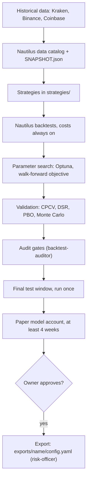

# Osprey - Strategy Lab

This is where our trading strategies are built, simulated at scale, validated against overfitting and luck, and approved. Approved strategies are exported as pinned configs. They run in production as NautilusTrader strategy nodes on paper "model accounts". Nothing in this repo ever places a real order.

[AGENTS.md](AGENTS.md) calls this repo the Strategy Lab (`strategy-lab`). This checkout is named `osprey`. The readers are the owner and the agent team: `data-engineer`, `quant-researcher`, `ml-researcher`, `backtest-auditor` and `risk-officer`.

## Status

> [!IMPORTANT]
> This repo holds only the docs, the `.gitignore` and the results dashboard.
> **The starter code is not in this repo yet.** That means `lab/`, its tests, `scripts/demo.py` and its `pyproject.toml`. The owner has it. Copy it in first: see [HOWTO: Set up the project](HOWTO.md#set-up-the-project).
> Milestones 0 to 5 are all not started.
> Live status: [dashboard/index.html](dashboard/index.html). Open it in a browser from your clone. GitHub shows the HTML source, not the page.

What is in this repo today:

| Path | What it is |
|---|---|
| [README.md](README.md) | This file |
| [HOWTO.md](HOWTO.md) | Task-by-task guide, with the status of each task |
| [AGENTS.md](AGENTS.md) | The owner's instructions to the agent team |
| [TESTING.md](TESTING.md) | Testing standard, bug log and the first work order |
| `.gitignore` | The list from AGENTS.md setup step 3, with `/data/`, `/results/` and `/mlruns/` anchored to the repo root so `lab/data/` is not ignored |
| `dashboard/` | Results dashboard: template, hand-edited status file, generated page ([dashboard/README.md](dashboard/README.md)) |
| [scripts/build_dashboard.py](scripts/build_dashboard.py) | Builds `dashboard/index.html` from files in this repo |
| [tests/test_dashboard.py](tests/test_dashboard.py) | Tests for the dashboard builder |

## How it works



- `data-engineer` builds the data catalog and measures costs.
- `quant-researcher` and `ml-researcher` build strategies and prediction models.
- `backtest-auditor` runs the validation gates and opens the test window once per strategy.
- `risk-officer` sets drawdown budgets and writes the export.
- Paper model accounts run in the production app, not in this repo.
- **The owner approves production. No agent approves its own work.**

## Quick start

This needs the starter code. Machine setup (uv, Python 3.13, the NautilusTrader reference clone) is in [HOWTO: Set up your machine](HOWTO.md#set-up-your-machine).

```bash
# First copy the starter code into this checkout (HOWTO: Set up the project).
uv sync                                                    # install everything in pyproject.toml
uv run python -c "import nautilus_trader as nt; print(nt.__version__)"   # must start with "2."
uv run pytest -m "not slow" -n auto                        # quick tier (every change)
uv run pytest -n auto --cov --cov-branch                   # full tier with coverage (before merging)
uv run python scripts/demo.py --trials 150 --workers 4     # end-to-end demo on synthetic data
python3 scripts/build_dashboard.py                         # rebuild dashboard/index.html
```

Then **start with [TESTING.md section 5](TESTING.md#5-open-work-in-order). It is the first work order.** Finish it before building anything new.

## What's built and what's left

"Built" means it exists in the starter code, which is not in this repo yet.

| Part | What it does | Status |
|---|---|---|
| `lab/runner/interface.py`, `lab/runner/reference.py` | The `BacktestFn` contract; a small reference backtester for tests and demos only | Built (starter code) |
| `lab/search/` | Optuna studies, walk-forward optimization, stable regions, reports | Built (starter code) |
| `lab/validation/` | Purged splits, CPCV, DSR, PBO, Monte Carlo | Built (starter code) |
| `lab/models/` | Features, labels, baselines, training, artifacts, live parity | Built (starter code) |
| `lab/data/loaders.py`, `lab/data/synthetic.py` | Kraken and Binance loaders; synthetic bars for tests and demos | Built (starter code) |
| `scripts/demo.py` | End-to-end demo on synthetic data | Built (starter code) |
| `lab/data/build.py` | Downloaders, quality checks, catalog writer, `SNAPSHOT.json` | To build (milestone 1) |
| `lab/costs/` | Nautilus fee model for Base DEX trading (`fees.py`: pool + aggregator + size-based slippage + gas, from `config/costs.yaml`; slippage charged as a fee, so no fill model is needed) | Built (milestone 2, 2026-11-25) |
| `lab/runner/nautilus.py` | `BacktestFn` on a NautilusTrader v2 `BacktestEngine` (one engine per run, disposed after use), running the reference rules' own decision code; passes the contract suite and the parity test; throughput in `scripts/nautilus_throughput.py` | Built (milestone 2, 2026-11-25); bars come from `lab.data.catalog.load_bars` |
| MLflow logging | Each trial (milestone 2) and each model version (AGENTS.md states no milestone) | Trials built (milestone 2, 2026-11-25: `lab/tracking/mlflow_log.py`, a SQLite store at `mlruns/mlflow.db`); model versions still to do |
| `strategies/` | The three launch strategies as Nautilus strategies | To build (milestone 3) |
| Audits on real data | Search and validation with the Nautilus runner; first audit reports | To build (milestone 4) |
| Prediction models on real data | Volatility, regime and Bold-list ranking models vs. baselines | To build (milestone 5) |
| `lab/reports/` | Audit reports and tearsheets | Not stated in AGENTS.md |
| `dashboard/`, `scripts/build_dashboard.py` | Results dashboard | In this repo |

## Milestones

From [AGENTS.md](AGENTS.md#milestones). Live status per milestone is on the dashboard.

| # | Milestone | Done when |
|---|---|---|
| 0 | Starter code verified | [TESTING.md](TESTING.md) definition of done met: full, deep and slow tiers pass; mutation targets met; demo rerun with the report and figures updated |
| 1 | Setup and data | Environment builds; BTC and ETH daily and hourly bars from Kraken and Binance in the catalog; `SNAPSHOT.json` written; data quality report committed |
| 2 | Costs and Nautilus runner | Fee and fill models in `lab/costs/` with tests; `lab/runner/nautilus.py` implements `BacktestFn` and passes the backtest contract suite; parity test against the reference passes; trials also logged to MLflow; throughput (trials per hour per core) measured |
| 3 | Launch strategies | The three strategies as Nautilus strategies, backtested on the train window with costs on, plus all benchmarks |
| 4 | Search and validation on real data | The demo pipeline rerun on real data with the Nautilus runner: walk-forward studies, CPCV, DSR, PBO, Monte Carlo; first audit reports written |
| 5 | Prediction track on real data | Volatility (5- and 20-day), regime and Bold-list ranking models vs. baselines with CPCV on real data; at least one model-sized strategy variant audited |

## Repo layout

From [AGENTS.md](AGENTS.md#repo-layout), plus this repo's own files. `(here)` marks what exists in this repo today. `(built)` is in the starter code, which is not here yet. `(to build)` is not written yet.

```
osprey/                          # AGENTS.md calls it strategy-lab/
├── README.md                    # (here) this file
├── HOWTO.md                     # (here) task-by-task guide
├── AGENTS.md                    # (here)
├── TESTING.md                   # (here) testing standard, bug log, open test work
├── .gitignore                   # (here)
├── .claude/agents/              # role files (see Desk roles)
├── config/
│   ├── splits.yaml              # global train / validate / test date ranges
│   ├── costs.yaml               # DEX cost model assumptions
│   └── risk_levels.yaml         # drawdown budgets and coin lists per risk level
├── dashboard/                   # (here) template.html, status.json, README.md, index.html (generated)
├── lab/
│   ├── data/                    # loaders (built), synthetic test data (built); downloaders + catalog writer (to build)
│   ├── costs/                   # Nautilus fee and fill model subclasses for Base DEX trading (to build)
│   ├── runner/                  # BacktestFn interface + reference backtester (built); Nautilus runner (to build)
│   ├── search/                  # Optuna studies, walk-forward optimization, stable regions, reports (built)
│   ├── validation/              # purged splits, CPCV, DSR, PBO, Monte Carlo (built)
│   ├── models/                  # features, labels, baselines, training, artifacts, live parity (built)
│   └── reports/                 # audit reports and tearsheets
├── scripts/
│   ├── demo.py                  # end-to-end demo on synthetic data (built)
│   └── build_dashboard.py       # (here) builds dashboard/index.html
├── strategies/<name>/           # strategy.py, params.yaml, README.md
├── research/                    # notebooks and scratch; never imported by lab/ or strategies/
├── exports/<name>/              # approved, pinned configs for production
├── reports/<name>/<date>.md     # audit reports (committed); the dashboard reads the <date>.json next to each
├── data/                        # git-ignored: raw downloads and the Nautilus catalog
├── results/                     # git-ignored: trial results (Parquet), Optuna journals, results/tests/ for the dashboard
└── tests/                       # property, leakage, known-answer, calibration and contract tests; test_dashboard.py (here)
```

## Rules that matter most

From [AGENTS.md: Hard rules](AGENTS.md#hard-rules-all-agents). Read the full list there.

- **No trading.** Nothing here sends orders or connects to wallets or the app backend.
- **No secrets in code or chat.** Keys load from env vars or a git-ignored `.env`. Never print or log a key.
- **NautilusTrader for every result that counts.** Scouting tools may suggest ideas; only Nautilus results go into reports.
- **No look-ahead.** Signals at bar *t* use data available at the close of bar *t*; fills happen no earlier than bar *t+1*.
- **Splits are fixed.** Nobody tunes on the test window. It is opened once per strategy, by `backtest-auditor`.
- **Costs are always on**, and finalists are re-run with costs doubled.
- **Every trial is logged**, failures included, with its data snapshot ID, git commit and seed.
- **Spot only.** No leverage, shorting, market making or arbitrage.
- **Ask the owner before** adding a dependency, changing `config/splits.yaml`, `config/costs.yaml` or `config/risk_levels.yaml`, or running anything that will cost money (cloud machines, paid data).
- **No result from failing code.** A backtest, search or audit only counts if the full test tier passed on that commit.

## Documentation

| Document | Read it for |
|---|---|
| [HOWTO.md](HOWTO.md) | How to do each task, and whether it can be done yet |
| [AGENTS.md](AGENTS.md) | The owner's instructions: pipeline, data, costs, splits, risk levels, gates, roles, milestones, commands |
| [TESTING.md](TESTING.md) | Testing standard, bug log, open test work (the first work order), definition of done |
| [dashboard/README.md](dashboard/README.md) | What the dashboard shows and how to rebuild it |

Not in this repo:

- `research-methods.md`. AGENTS.md links to it several times and says to read it first, but it isn't here yet. Those links are broken until it is added. Ask the owner for it.
- The app docs (`../caas-app/README.md`). They live in the app's repo, outside this one.

## Dashboard

`dashboard/index.html` is one self-contained page built from files in this repo. It shows milestones, each strategy's lifecycle and audit gates, test health, the data snapshot, local search runs and reports. It works offline. Status that no file records yet (milestones, paper accounts, open test work) comes from `dashboard/status.json`, which the team edits by hand. Rebuild it after any change:

```bash
python3 scripts/build_dashboard.py
```

Inputs, the commands that produce them and the audit JSON format are in [HOWTO: Dashboard](HOWTO.md#dashboard).
